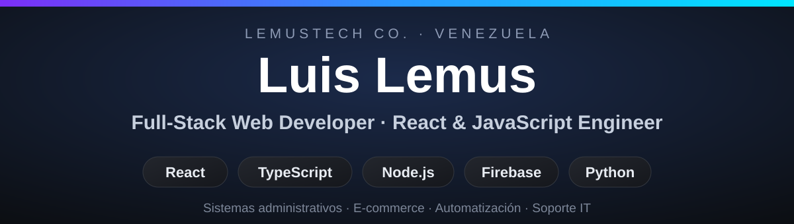

### 👋 Hola, soy Luis Lemus

Fundador de **Lemustech Co.** Construyo **sistemas administrativos, e-commerce y aplicaciones web en tiempo real** para negocios que necesitan vender y operar sin fricción — y doy soporte técnico integral en Windows, macOS y Linux.

  

---

## 🌟 Proyecto más reciente

### 🟣 [Loomus Studio](https://github.com/lemustech/loomus)

**La suite de grabación de pantalla moderna, profesional y 100% privada para macOS y Apple Silicon.**
Graba tu pantalla y tu cámara en una burbuja flotante, dibuja en vivo con herramientas neón y lee tu guion en un teleprompter invisible — sin límites de tiempo y sin subir tus videos a la nube. **Gratis y open source.**

---

## 🚀 Lo que hago

- 🧾 **Sistemas administrativos & POS** — ventas, inventario y reportes en tiempo real con Firebase
- 🛒 **E-commerce & catálogos** — tiendas y catálogos con pedidos directos por WhatsApp
- 🤖 **Automatización** — bots de WhatsApp y herramientas a medida con Node.js y Python
- 🛠️ **Soporte técnico & redes** — diagnóstico, optimización y configuración en Windows, macOS y Linux

## 🛠️ Tech Stack

  
   
  

### 🤖 Desarrollo asistido por IA

  
  
  

## 📂 Proyectos destacados

| Proyecto | Descripción |
| :--- | :--- |
| **[Loomus Studio](https://github.com/lemustech/loomus)** | Grabador de pantalla profesional y 100% privado para macOS (Apple Silicon): cámara flotante, anotaciones neón en vivo y teleprompter invisible. Open source (MIT). |
| **[NegociOS Pro](https://github.com/lemustech/negociOS)** | Sistema administrativo y punto de venta (POS) en tiempo real con Firebase: ventas e inventario desde cualquier dispositivo. |
| **[GV Soluciones Administrativas](https://solybusiness.com/gvsoluciones)** | Suite administrativa empresarial en tiempo real (Vue + Firebase) con integración por WhatsApp. |
| **Lemustech Manager & Store** | CRM + e-commerce para la gestión de suscripciones digitales, seguimiento de clientes, renovaciones y pagos. |
| **[Novabrands](https://github.com/lemustech/novabrands)** | Catálogo e-commerce de gorras premium (Premium Headwear) conectado a Firebase. |
| **[EXPO GPM 2026](https://lemustech.net/clientes/expografica)** | Landing oficial de la 7ma edición del evento de Gráfica, Publicidad y Marketing (Caracas): registro, pases QR y WhatsApp. |
| **[Lucky Paws Pet Services](https://lemustech.net/clientes/mascota)** | Sitio web para negocio de cuidado de mascotas (pet sitting & dog walking). |
| **[Rastreo & Gestión · T&K Company](https://lemustech.net/clientes/tyk/index.html)** | Interfaz web corporativa en tiempo real para logística: pedidos, inventarios y estatus de pagos. |
| **[MediTrans · MedX](https://lemustech.net/clientes/medx)** | Aplicación de movilidad médica VIP: traslados médicos con contacto directo por WhatsApp. |
| **WhatsApp CRM Bots** | Bots y automatización de atención con Node.js (`whatsapp-web.js`), Python y Selenium. |
| **Lemustech SystemBoost Hub** | Suite multiplataforma (Windows, macOS, Linux) de diagnóstico y optimización profunda del sistema. |
| **[Asistente de Redacción IA](https://lemustech.net/clientes/herramientas)** | Herramienta web con IA que detecta textos duplicados y corrige el estilo con visor de cambios detallado, tonos personalizables e historial. |
| **[AsaPokeTCG (Retro)](https://asapoketcg.com)** | Tienda oficial de cartas, cajas y accesorios Pokémon TCG: experiencia pixel-art estilo Game Boy con Web Audio API, catálogo en Firebase y pedidos por WhatsApp. |

## 📊 GitHub en números

  
  
    
  
    
  
    
  

---

### 📫 Hablemos de tu proyecto

📲 **WhatsApp:** +58 424-1353496 · ✉️ **Soporte@Lemustech.net** · 📸 **@Lemustech.ve**

Lemustech Co. · Hecho desde Venezuela 🇻🇪

 

